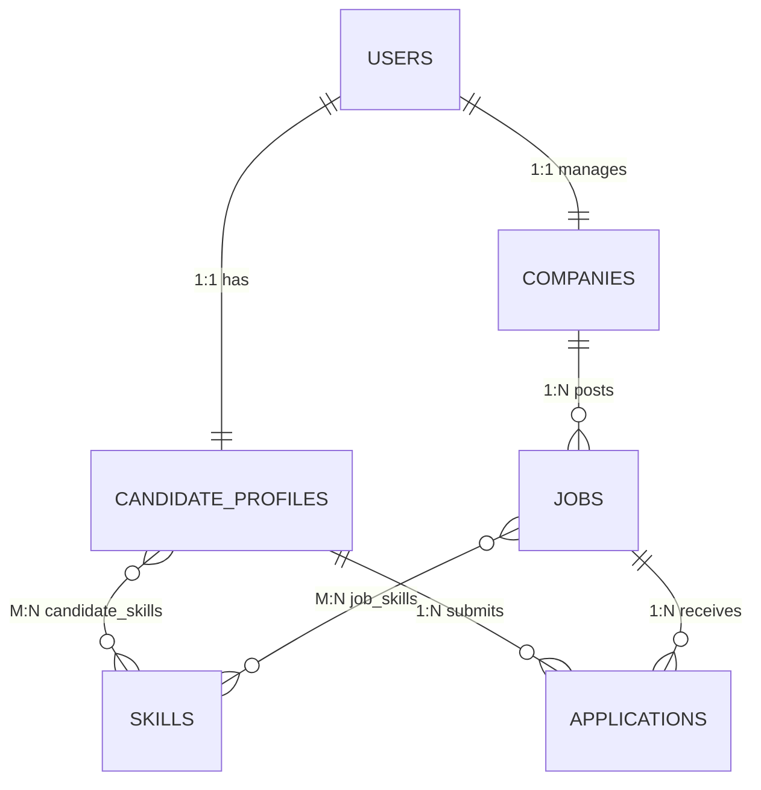

<div align="center">

  

  # 💼 Velai Portal
  ### *Full-Stack Career & Recruitment Platform*

  [](https://www.oracle.com/java/)
  [](https://spring.io/projects/spring-boot)
  [](https://spring.io/projects/spring-security)
  [](https://www.mysql.com/)
  [](https://developer.mozilla.org/en-US/docs/Web/JavaScript)
  [](https://developer.mozilla.org/)

  <p align="center">
    A scalable, role-aware recruitment management ecosystem connecting top engineering talent with hiring organizations. Built from scratch with zero heavy frontend framework dependencies and hardened by stateless JWT access controls.
  </p>

</div>

---

## 📌 Platform Overview

**Velai Portal** is designed to streamline tech hiring with strict separation of concerns across three dedicated personas:

* **Candidates**: Discover verified engineering openings, maintain dynamic skill profiles, track applications across live statuses, and prevent accidental duplicate submissions[cite: 4].
* **Recruiters**: Manage organizational branding, publish/edit/delete job posts, and evaluate candidates via an interactive applicant review modal[cite: 4].
* **Admins**: Platform oversight with live telemetry counters, user account moderation, and cross-company job moderation[cite: 4].

---

## ⚙️ Core Architecture


```

[ Web Browser Client ]
│
▼  (JSON Payloads + Bearer Token)
[ REST API / Spring Boot Gateway ]
│
├─► [ Spring Security & JWT Filter Chain ]
│         └─► Role Validation (CANDIDATE | RECRUITER | ADMIN)
│
├─► [ Service Layer ]
│         ├─► Business Rules (Duplicate Prevention, Authorization Guards)
│         └─► Cascade Cleanup & Transaction Management
│
▼  (Spring Data JPA / Hibernate)
[ MySQL Relational Database ]
├─► users & roles
├─► candidate_profiles ◄──► skills (ManyToMany)
├─► companies ◄──► jobs ◄──► job_skills (ManyToMany)
└─► applications (Candidate-Job Relationship Bridge)

```

---

## ✨ Key Features

### 🔐 1. Stateless Security & Role-Based Access Control (RBAC)
* Token-based authentication using **JSON Web Tokens (JWT)** and **BCrypt** password hashing.
* Method-level endpoint defense using `@PreAuthorize("hasRole(...)")`.
* Contextual navigation: views and operational buttons automatically adapt and lock based on token role claims[cite: 4].

### 👨‍💻 2. Candidate Engine
* **Skill Tags & Profile Hub**: Manage education, years of experience, contact details, portfolio links, and technical skill tags[cite: 4].
* **Real-Time Duplicate Defense**: Attempts to re-apply for active openings are rejected both server-side (HTTP 400) and client-side (dynamic `✓ Applied` badge state)[cite: 4].
* **Application Tracker**: Monitor pipeline statuses (`APPLIED`, `SHORTLISTED`, `INTERVIEW`, `SELECTED`, `REJECTED`) or voluntarily withdraw submissions[cite: 4].

### 🏢 3. Recruiter Workspace
* **Company Profiles**: Public branding profiles linked 1-to-1 with recruiter accounts.
* **Job Management**: Full lifecycle CRUD for job listings (creation, editing details/deadlines, deletion)[cite: 4].
* **Candidate Review Modal**: Inspect applicant initials, contact info, education, experience, resume links, and update recruitment pipeline statuses with foreground toast alerts[cite: 4].

### 🛡️ 4. Administration & Platform Moderation
* Live platform telemetry counters: total users, total active jobs, and total applications[cite: 4].
* Global directory moderation with the ability to delete spam users or remove outdated job postings platform-wide[cite: 4].

---

## 🛠️ Tech Stack

| Domain | Technology / Library | Purpose |
| :--- | :--- | :--- |
| **Backend Framework** | Java 17+, Spring Boot 3.x | Enterprise application foundation |
| **Data Persistence** | Spring Data JPA / Hibernate | ORM mapping and relational integrity[cite: 1] |
| **Security Layer** | Spring Security 6, JJWT, BCrypt | Stateless authorization and password hashing |
| **Database** | MySQL 8.0 | ACID-compliant relational data store[cite: 1] |
| **Frontend UI** | HTML5, Modern CSS3 | Responsive interface with hover scale animations[cite: 4] |
| **Frontend Scripting**| JavaScript (Fetch API) | Asynchronous client communication and dynamic DOM routing[cite: 4] |

---

## 🗄️ Database Entity Schema



---

## 🚀 API Endpoints Overview

## 🚀 API Endpoints Overview

<details>
<summary><b>Click to expand REST API Route Map</b></summary>

### 🔑 Authentication (`/api/auth`)
* `POST /api/auth/register` - Create Candidate or Recruiter account
* `POST /api/auth/login` - Authenticate and retrieve Bearer JWT

### 💼 Jobs (`/api/jobs`)
* `GET /api/jobs` - Browse active jobs (supports `?title=` and `?location=` filters)[cite: 4]
* `POST /api/jobs` - Publish new opening *(Recruiter only)*
* `PUT /api/jobs/{id}` - Update job details *(Owner Recruiter only)*
* `DELETE /api/jobs/{id}` - Delete job post *(Owner Recruiter or Admin)*

### 📝 Applications (`/api/applications`)
* `POST /api/applications` - Submit job application *(Candidate only)*
* `GET /api/applications/my` - View user's submitted applications[cite: 4]
* `GET /api/applications/job/{jobId}` - View candidates for a job *(Recruiter only)*[cite: 4]
* `PUT /api/applications/{id}/status` - Update candidate status *(Recruiter only)*[cite: 4]
* `PUT /api/applications/{id}/withdraw` - Withdraw application *(Candidate only)*[cite: 4]

### 👤 Profiles & Organizations
* `GET /api/candidate-profile/me` - Retrieve candidate details[cite: 4]
* `PUT /api/candidate-profile/me` - Update skills, bio, resume URL[cite: 4]
* `GET /api/company/me` - View recruiter company details[cite: 4]
* `PUT /api/company/me` - Update company branding[cite: 4]

### 🛡️ Administration (`/api/admin`)
* `GET /api/admin/metrics` - Platform performance telemetry[cite: 4]
* `GET /api/admin/users` - Global user directory[cite: 4]
* `DELETE /api/admin/users/{id}` - Moderate/remove platform user[cite: 4]
* `DELETE /api/admin/jobs/{id}` - Remove posting platform-wide[cite: 4]

</details>

---

## 💻 Local Setup & Installation

### Prerequisites
* **Java JDK 17+**
* **Maven 3.8+**
* **MySQL Server 8.0+**
* Any local HTTP server or VS Code Live Server extension

### 1. Database Configuration
Create a database in your local MySQL instance:
```sql
CREATE DATABASE job_portal;

```

Update `backend/jobPortal/src/main/resources/application.properties`:

```properties
spring.datasource.url=jdbc:mysql://localhost:3306/job_portal?createDatabaseIfNotExist=true
spring.datasource.username=YOUR_MYSQL_USERNAME
spring.datasource.password=YOUR_MYSQL_PASSWORD
spring.jpa.hibernate.ddl-auto=update

```

### 2. Run the Backend API

```bash
cd backend/jobPortal
mvn clean spring-boot:run

```

*API will spin up on `http://localhost:8080`.*

### 3. Launch the Frontend Client

Open the `frontend` folder with **Live Server** in VS Code, or serve using Python / Node:

```bash
cd frontend
# Using Python:
python3 -m http.server 5500
# OR using Node.js:
npx serve -l 5500

```

Open `http://localhost:5500` in your web browser.

---

## 👨‍💻 Author

* **Abinesh S** - *Full-Stack Developer*

---